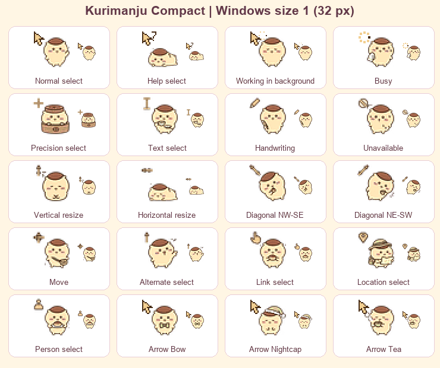
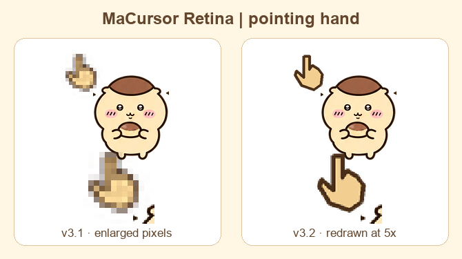

# Chiikawa & Kurimanju Animated Cursors 🩷🌰

เคอร์เซอร์เมาส์ขยับได้สำหรับเพื่อนตัวเล็กบนหน้าจอ — มีทั้งชิกาว่าและคุริมันจู พร้อมท่าทางที่แตกต่างกันตามการใช้งาน

Cute animated desktop cursors for Windows 10/11 and macOS (via MaCursor, or legacy Mousecape). An unofficial personal-use fan project.

  

## ดาวน์โหลด · Download

เลือกตัวละครและรุ่นที่เหมาะกับการใช้งานได้เลย ทั้งสองตัวมี 17 สถานะของ Windows และลูกศรพิเศษอีก 3 แบบใน v3/Compact

| Edition | Chiikawa 🩷 | Kurimanju 🌰 |
| :--- | :---: | :---: |
| **Compact · Size 1** (32 px, Windows) ⭐ Recommended | [Download ZIP](v3/compact/Chiikawa_Compact_Size1.zip?raw=true) | [Download ZIP](v3/compact/Kurimanju_Compact_Size1.zip?raw=true) |
| **MaCursor v3.2 Retina Beta** (modern macOS) 🍎 Recommended for Mac | [Download ZIP](v3/macos/Chiikawa_MaCursor_v3_2.zip?raw=true) | [Download ZIP](v3/macos/Kurimanju_MaCursor_v3_2.zip?raw=true) |
| **Typing Stable** (optional Windows Text Select add-on) | [Download ZIP](v3/compact/Chiikawa_Typing_Stable_Test.zip?raw=true) | — |
| **Standard v3** (96 / 128 px, Windows + legacy Mousecape) | [Download ZIP](v3/Chiikawa_Animated_Friends_v3.zip?raw=true) | [Download ZIP](v3/Kurimanju_Animated_Friends_v3.zip?raw=true) |
| **Legacy v2** (32 / 48 / 64 px, Windows) | [Download ZIP](Chiikawa_Animated_Cursors_v2.zip?raw=true) | — |

> **แนะนำ:** ถ้าใช้ขนาดเมาส์ (Size) ระดับ 1 บน Windows ให้เลือก **Compact** ก่อน น้องตัวใหญ่ขึ้นในพื้นที่เดิม เส้นและดวงตาชัดขึ้น โดยไม่ต้องเพิ่มขนาดเคอร์เซอร์ของระบบ

> **Mac รุ่นใหม่:** ใช้ **MaCursor v3.2 Retina Beta** แทน Mousecape รุ่นเดิม v3.2 วาดสัญลักษณ์เมาส์ใหม่สำหรับจอ Retina โดยตรง ไม่ขยายภาพพิกเซลต่ำแบบ v3.1 และเพิ่ม 10x representation เพื่อรองรับการขยายขนาดภายใน MaCursor โดยไม่ต้องเปลี่ยนการตั้งค่า macOS

> **พิมพ์งานบ่อย:** Typing Stable เป็นตัวเลือกทดลองเฉพาะ Text Select (IBeam) แบบนิ่ง ส่วนเคอร์เซอร์อื่นยังเคลื่อนไหวเหมือนเดิม

## ตัวอย่าง · Previews

### Compact — Windows Size 1

| Chiikawa | Kurimanju |
| :---: | :---: |
|  |  |

### MaCursor — Retina v3.2

รุ่น MaCursor v3.1 ก่อนหน้า · Previous Mac version (fallback)

[Chiikawa v3.1 ZIP](v3/macos/Chiikawa_MaCursor_v3.zip?raw=true) · [Kurimanju v3.1 ZIP](v3/macos/Kurimanju_MaCursor_v3.zip?raw=true)

ดู Standard v3 · View 96 / 128 px previews

| Chiikawa | Kurimanju |
| :---: | :---: |
|  |  |

ดูเวอร์ชันเดิม · Legacy v2 preview

## สิ่งที่มีในชุด · What's included

- **17 cursor roles:** ลูกศรปกติ, เลือกข้อความ, รอโหลด, เลือกลิงก์, ย้ายและปรับขนาดหน้าต่าง ฯลฯ พร้อมท่าทางเฉพาะแต่ละสถานะใน v3/Compact
- **12-frame animations** ใน v3/Compact: เด้งตัว เอียงตัว และขยับเบา ๆ โดยจุดคลิกไม่เปลี่ยน
- **3 bonus normal pointers** ต่อขนาด เช่น โบว์ ผ้าพันคอ หมวกนอน หรือจิบชา
- พื้นหลังโปร่งใส ไฟล์เคลื่อนไหว `.ani` และภาพนิ่ง `.cur` สำหรับ Windows
- ไฟล์ `.cursor` สำหรับ [MaCursor](https://github.com/writronic/MaCursor) โดยตรง (45 cursor identifiers, including modern macOS aliases, 32-point geometry and 1x / 2x / 5x / 10x Retina representations in v3.2)
- ไฟล์ `.cape` สำหรับ Mousecape รุ่นเดิมใน Standard v3 พร้อมภาพตัวอย่างและคู่มือการติดตั้ง

## วิธีติดตั้ง · Installation

### Windows 10 / 11

1. ดาวน์โหลด ZIP ของตัวละครที่ชอบ แล้ว **แตกไฟล์ทั้งหมด (Extract All)** ก่อน
2. **Compact:** เปิด `Install.cmd` ที่โฟลเดอร์หลัก ตัวติดตั้งจะตั้งค่า Windows pointer Size 1 (32 px) และเปลี่ยนทั้ง 17 สถานะ
3. **Standard:** เลือก `Windows/96` หรือ `Windows/128` แล้วเปิด `Install.cmd` (สำหรับ v2 เลือก `32`, `48` หรือ `64`)
4. ไม่ต้องใช้สิทธิ์ Administrator หากไม่เปลี่ยนทันที ให้ Sign out แล้ว Sign in ใหม่

หากต้องการเปลี่ยนเฉพาะลูกศรปกติหรือเลือกแบบในโฟลเดอร์ `Bonus` ให้เปิด **Mouse Properties → Pointers → Normal select → Browse** แล้วเลือกไฟล์ `.ani` หรือ `.cur`

คุณสามารถตรวจขนาดเมาส์ได้ที่ **Settings → Accessibility → Mouse pointer and touch → Size** ขนาดจริงบนจอขึ้นอยู่กับการตั้งค่าและความละเอียดหน้าจอ ไม่จำเป็นต้องตรงกับขนาดไฟล์ต้นฉบับเสมอไป

**Typing Stable (optional):** แตก ZIP ตัวเสริมและเปิด `Install.cmd` เพื่อเปลี่ยนเฉพาะ Text Select เป็นภาพนิ่ง เปิด `Restore.cmd` ของตัวเสริมเพื่อคืนค่า Text Select เดิม หากเมาส์หายขณะพิมพ์ ให้ตรวจ **Mouse Properties → Pointer Options → Hide pointer while typing** และยกเลิกการเลือกหากต้องการให้เมาส์ยังแสดงอยู่ ตัวเสริมไม่เปลี่ยนการตั้งค่านี้โดยอัตโนมัติ และบางแอปอาจซ่อนเมาส์เองได้

### macOS · MaCursor (แนะนำ / Recommended)

1. ดาวน์โหลด **MaCursor v3.2 Retina Beta** ของตัวละครที่ชอบ แล้วแตก ZIP
2. ดาวน์โหลด [MaCursor](https://github.com/writronic/MaCursor/releases) จากผู้พัฒนาและติดตั้ง Helper Tool ตามขั้นตอนในแอป
3. เปิดไฟล์ `.cursor` หรือเลือก **File → Import Theme** แล้วกด **Apply**
4. ปรับ **Cursor Scale** ภายใน MaCursor ตามต้องการ (เริ่มที่ 1x) ไม่จำเป็นต้องเปลี่ยนการตั้งค่าขนาดเมาส์ใน macOS

MaCursor ระบุรองรับ macOS 13 ขึ้นไป รวมถึง macOS 26 Tahoe และ macOS 27 Golden Gate ใน [README ของโครงการ](https://github.com/writronic/MaCursor). ผู้ใช้ Mac สามารถเปิดธีม v3.1 ได้แล้ว แต่พบสัญลักษณ์มือแตกเป็นพิกเซลเมื่อขยาย จึงแก้ใน v3.2; รุ่นใหม่ยังรอทดสอบจริง

### macOS · Legacy Mousecape (ทางเลือกสำหรับรุ่นเดิม)

1. ดาวน์โหลด **Standard v3** และติดตั้ง [Mousecape](https://github.com/alexzielenski/Mousecape/releases) พร้อม Helper Tool ตามคู่มือของโปรแกรม
2. เปิดไฟล์ `.cape` จากโฟลเดอร์ `macOS` และเลือกขนาด 96 หรือ 128
3. กด **Apply**

การรองรับขึ้นอยู่กับ macOS และ Mousecape ที่ใช้งาน หากใช้งานไม่ได้ ให้เลือก MaCursor ด้านบน (Compact และ Legacy v2 เป็นรุ่นสำหรับ Windows เท่านั้น)

### คืนค่า · Restore

- Compact: เปิด `Restore.cmd` ในโฟลเดอร์หลัก
- Standard: เปิด `Windows/Restore.cmd`
- Legacy v2: เปิด `Restore.cmd` ในโฟลเดอร์หลัก

v3/Compact ใช้ข้อมูลสำรองร่วมกันเพื่อให้สลับตัวละครได้โดยไม่ทับค่าก่อนติดตั้งครั้งแรก ส่วน macOS ให้ใช้ตัวเลือกคืนค่าเริ่มต้นใน MaCursor หรือ Mousecape ที่ใช้งานอยู่

## สถานะการทดสอบ · Verification

| Check | Status |
| :--- | :--- |
| ZIP integrity, native Windows cursor loading, ANI/CUR structure and alpha masks | ✅ Passed (240 v3/Compact files) |
| Chiikawa Compact normal pointer on a 27-inch monitor | ✅ User confirmed clearer eyes and outlines |
| Chiikawa Compact installation at Windows Size 1 | ✅ All 17 active cursor paths verified |
| Mousecape `.cape` and animation strips | ✅ Structurally validated |
| MaCursor `.cursor` themes, slots, hotspots and 1x/2x/5x/10x image strips | ✅ Structurally validated; v3.2 redrawn high-resolution symbols |
| MaCursor v3.1 real-world feedback | ✅ Imported and displayed on Mac; pixelated hand prompted v3.2 |
| Typing Stable IBeam add-on | ✅ Uses the verified Compact first frame; installer syntax checked |
| v3.2 Mac import/apply/playback, Typing Stable live use and restore | ⏳ Awaiting user testing |

Legacy v2: all 102 cursor files passed read-only native Windows loading and ZIP integrity checks. Live playback and restore have not been verified exhaustively.

## About

Unofficial, non-commercial fan art for personal use. Chiikawa and Kurimanju and their rights belong to their respective rights holders. This project is not affiliated with or endorsed by the character creators. No license to the underlying character artwork is granted.
