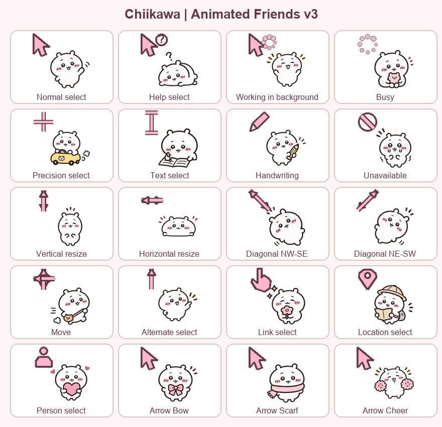
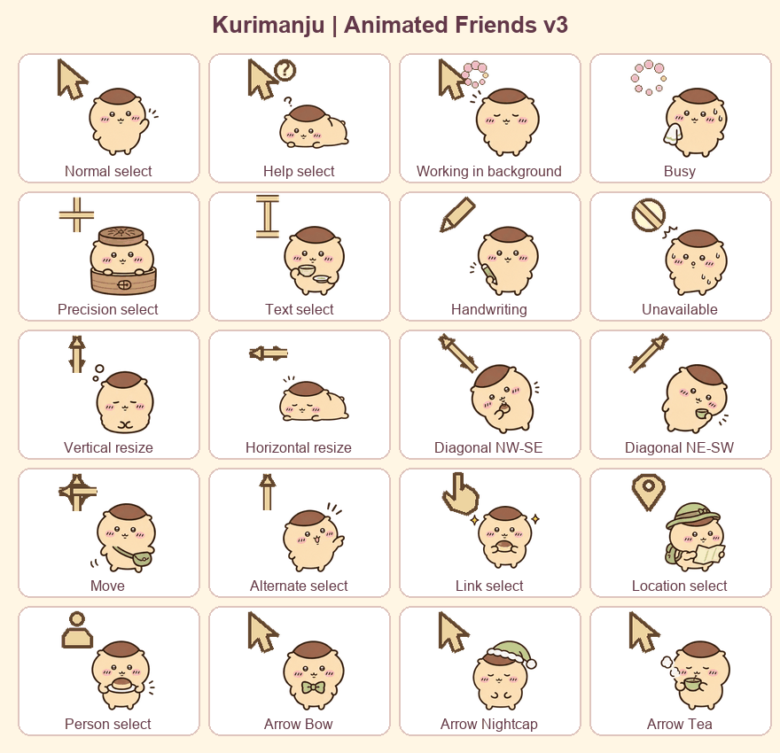
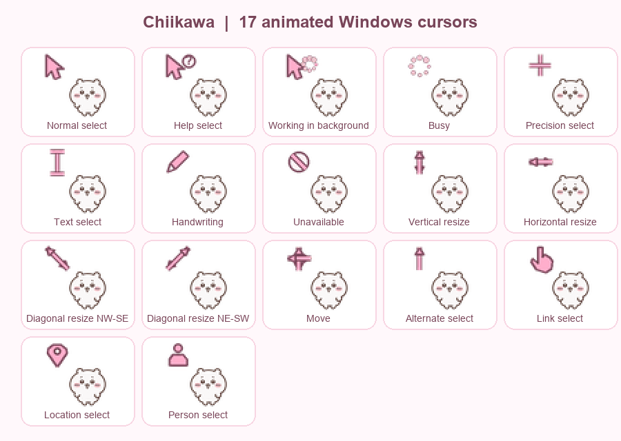

# Chiikawa Animated Cursors 🩷

เคอร์เซอร์ชิกาว่าและคุริมันจูขยับได้สำหรับ Windows 10 / 11 และ macOS (ผ่าน Mousecape)

## Animated Friends v3 — ใหม่ / New

| Chiikawa 🩷 | Kurimanju 🌰 |
|---|---|
|  |  |
| [Download Chiikawa v3 (.zip)](v3/Chiikawa_Animated_Friends_v3.zip) | [Download Kurimanju v3 (.zip)](v3/Kurimanju_Animated_Friends_v3.zip) |

- 17 Windows cursor roles, each with a different character pose and role-specific pointer symbol.
- 96 × 96 px (medium) and 128 × 128 px (large); each size also includes three alternate normal pointers.
- 12-frame animations with gentle bounce, tilt, squash, or rocking. Click hotspots stay fixed.
- Animated `.ani` and static `.cur` files for Windows, plus two `.cape` files for macOS using [Mousecape](https://github.com/alexzielenski/Mousecape).
- Transparent backgrounds, animated previews, pose sheets, and installation/restore instructions inside each ZIP.

### ติดตั้ง v3 / Install v3

**Windows:** แตก ZIP แล้วเลือก `Windows/96` หรือ `Windows/128` จากนั้นเปิด `Install.cmd` ไม่ต้องใช้สิทธิ์ Administrator ใช้ `Windows/Restore.cmd` เพื่อคืนค่าก่อนติดตั้ง v3 ครั้งแรก ทั้งสองชุดใช้ข้อมูลสำรองร่วมกัน จึงสลับตัวละครได้โดยไม่เสียข้อมูลเคอร์เซอร์เดิม

**macOS:** ติดตั้ง [Mousecape](https://github.com/alexzielenski/Mousecape/releases) และ Helper ตามคู่มือ เปิดไฟล์ `.cape` ในโฟลเดอร์ `macOS` จากนั้น Apply. การรองรับขึ้นอยู่กับ macOS และ Mousecape รุ่นที่ใช้งาน

**Verification:** Both v3 ZIPs passed integrity checks. All 160 Windows `.ani` and `.cur` files (including bonus variants) loaded successfully through the native Windows cursor loader. ANI structure, frame counts, hotspots, alpha masks, and PowerShell script syntax were checked. The four Mousecape plists and their animation image strips were structurally validated. Actual scheme installation, live animation, restore, and Mac compatibility have not been tested on a running desktop. Displayed cursor size may vary with OS scaling or application behavior.

## Chiikawa v2 — เวอร์ชันก่อนหน้า / Previous version

### ดาวน์โหลด / Download v2

[**Chiikawa Animated Cursors V2 (.zip)**](https://github.com/Netthip/chiikawa-animated-cursors/raw/refs/heads/main/Chiikawa_Animated_Cursors_v2.zip)

- 17 Windows cursor roles × 3 sizes (32, 48, 64 px)
- 51 animated `.ani` files with 8 frames each, plus 51 static `.cur` alternatives
- Transparent backgrounds and role-specific pink pointer symbols
- Install and restore scripts; no background app required

### วิธีติดตั้ง / Installation v2

1. ดาวน์โหลด ZIP และแตกไฟล์ทั้งหมด (Extract All)
2. เปิดโฟลเดอร์ขนาดที่ต้องการ: `32`, `48` (แนะนำ) หรือ `64`
3. ดับเบิลคลิก `Install.cmd` เพื่อใช้ชุดเคอร์เซอร์ ไม่ต้องใช้สิทธิ์ Administrator
4. หากต้องการกลับไปใช้เคอร์เซอร์ก่อนติดตั้ง ให้เปิด `Restore.cmd` ในโฟลเดอร์หลัก

หากไม่ต้องการเรียกสคริปต์ ให้เปิด Windows Mouse Properties → Pointers แล้วเลือกไฟล์ `.ani` หรือ `.cur` ให้ตรงกับแต่ละสถานะ ดูรายละเอียดใน `README.txt` ภายใน ZIP

### Verification v2

All 102 cursor files passed a read-only native Windows loading check. The ZIP contents and PowerShell syntax were also checked. Live Windows animation playback, actual installation/restore, and per-app behavior have not yet been tested. All roles reuse the same approved eight-frame hopping animation; the pointer symbols and hotspots distinguish each role.

## Fan project

Unofficial, non-commercial fan project made for personal use. Chiikawa and its character rights belong to their respective rights holders. This project is not affiliated with or endorsed by the character's creators. No license to the underlying character artwork is granted by this repository.
